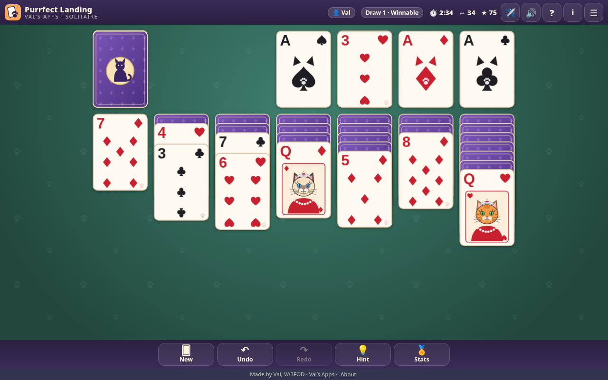
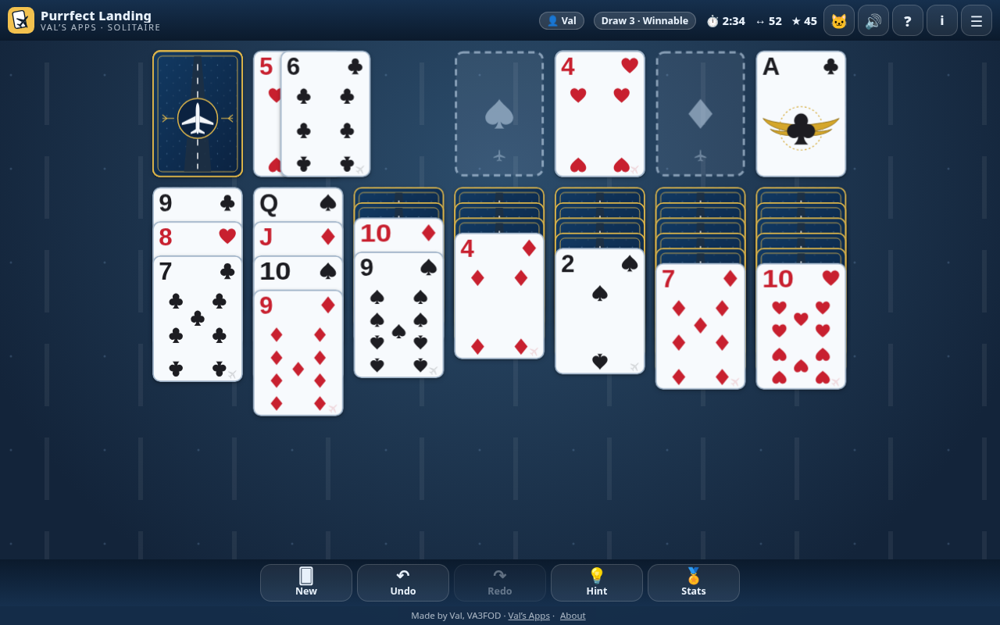
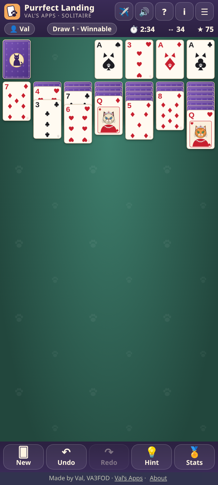
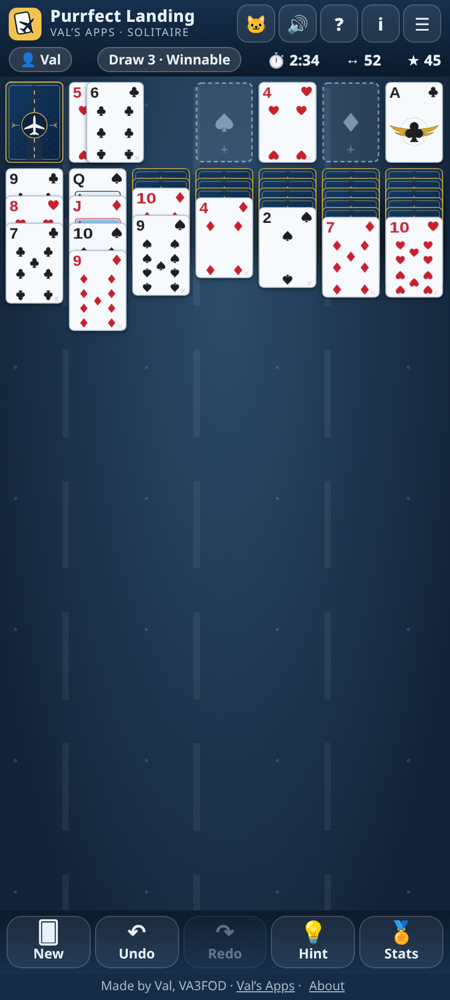
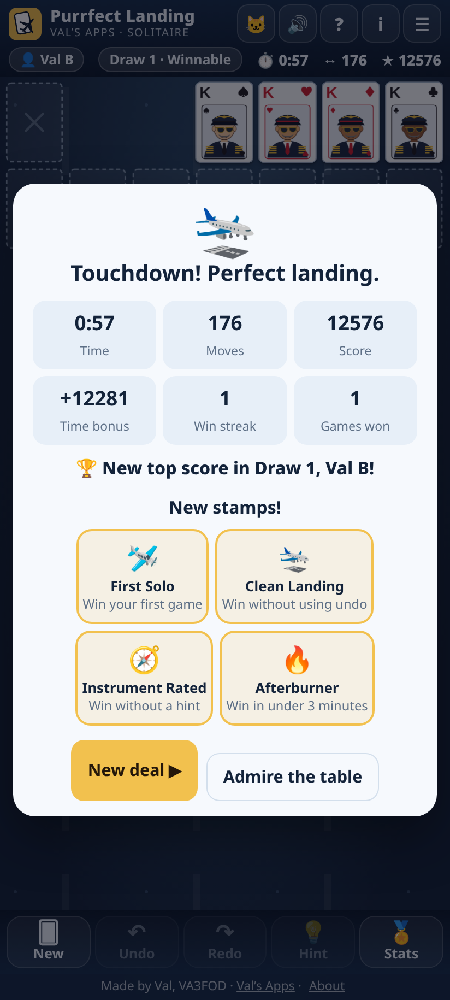
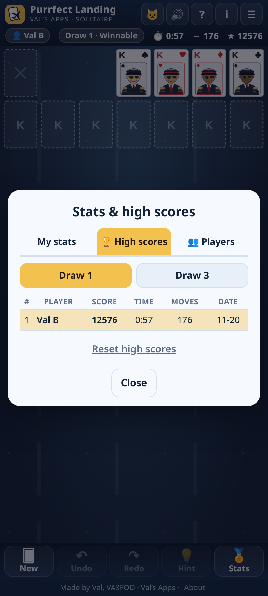
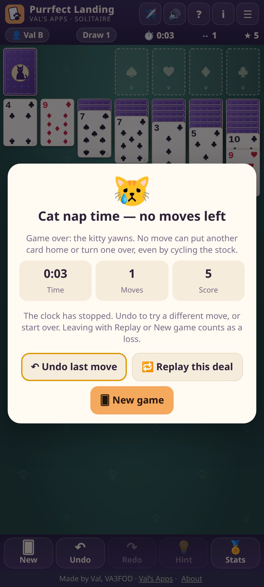
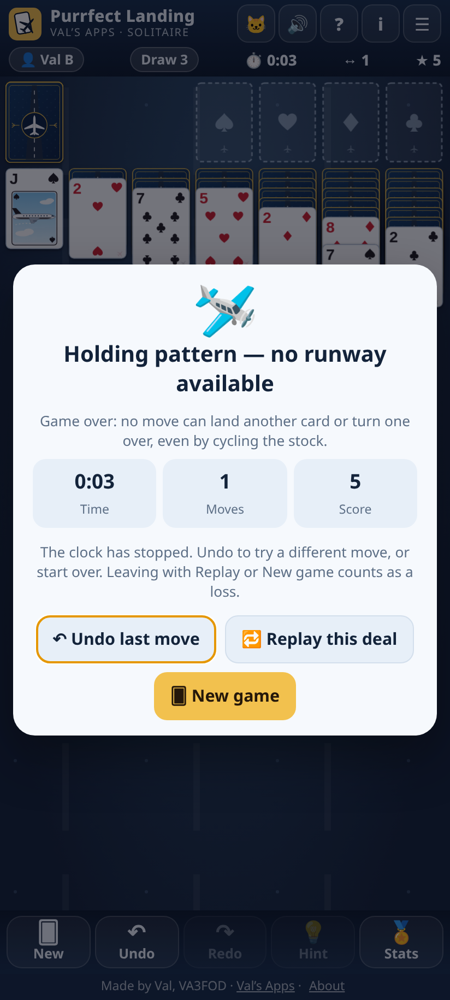

# Purrfect Landing Solitaire

Klondike solitaire with two themes you can switch anytime: **cats** and **aviation**.

▶ **Play it:** https://va3fod.github.io/Purrfect-Landing-Solitaire/

Part of [Val’s Apps](https://va3fod.github.io/).

| Cat theme | Aviation theme |
|---|---|
|  |  |

| Phone, cats | Phone, aviation | Win | High scores |
|---|---|---|---|
|  |  |  |  |

| Stuck, cats | Stuck, aviation |
|---|---|
|  |  |

## What makes it different

- **Two full themes.** Cat-illustrated cards (the King is a big tomcat, the Jack is a kitten with yarn) or pilots and aircraft. Each theme has its own table, card backs, sounds and win celebration: cats chasing cards across the table, or a plane flyby with card contrails.
- **Themed sounds.** Cats: a meow on the deal and the win, a purr on the foundation, paw taps as cards move and a hiss for a move that isn’t allowed. Aviation: engine spool-up, a radio chime, whooshes, a warning horn and a flyby. One tap mutes it.
- **Winnable deals.** With this on, every deal has already been solved by the built-in solver.
- **Daily challenge.** The same winnable deal for everyone each day.
- **Smart hint** that looks ahead with the solver, **unlimited undo and redo**, and **auto-finish** once every card is face up.
- **Draw 1 or Draw 3**, with classic scoring and a capped time bonus: 1000 × 240 ÷ (seconds + 240), so at most 1000 points. A fast win helps, but good play counts for more. Only wins go on the high-score table.
- **Stuck = game over.** If no move can ever put another card home or turn one over, even by cycling the stock, the clock stops and a themed Game over screen appears (*Cat nap time* or *Holding pattern*). Undo your last move to keep playing, or replay the deal or start a new one; those two count as a loss.
- **Players and high scores.** Several people can share a device. Each player has their own stats, and the top 10 scores for Draw 1 and Draw 3 are kept with name, time, moves and date.
- **Stamps** to collect, like *Cat Nap* or *Barrel Roll*, plus win streaks and best times.
- **Easy to use for everyone:** a left-handed layout, large cards and colour-blind-friendly suit colours.
- **Phone and desktop.** On a phone you tap or drag cards. On a computer you use the mouse (drag, click or double-click) and keys: U undo, R redo, H hint, N new deal, Space draw, A auto-finish, T theme, M sound.

It is one HTML file that works offline. There are no ads, no sign-up and no tracking, and everything is saved only on your device. Open it in Safari or Chrome, not in a WhatsApp preview.

## Development

```
npm install         # playwright-core, for the browser tests
npm run build       # src/ → index.html (+ a versioned copy for releases)
npm test            # rules engine, solver, save/load, players and high scores
npm run e2e         # browser tests: desktop 1280×800, phone 412×915 and landscape, both themes
```

All card art is drawn in code (SVG) and all sounds are made with WebAudio. The list of winnable deals in `src/seeds.json` comes from `tools/gen-seeds.js`. Each deal there was solved and the solution was replayed through the rules engine.

If you enjoy it, you can send a tip by Interac e-Transfer to aschiuta@gmail.com. Tips are optional — the game stays free.

Made by Val, VA3FOD
